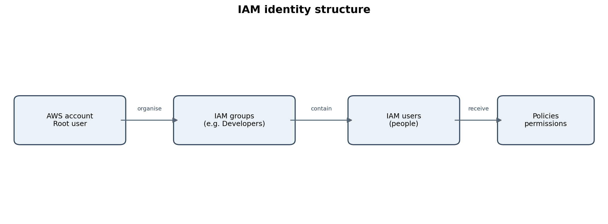

# 1. IAM Foundations

## What is AWS IAM?

**AWS Identity and Access Management (IAM)** is the AWS service used to manage identities and control who can access AWS resources and what actions they can perform.

- IAM is a **global service**.
- An AWS account has a root user by default.
- IAM users represent people who need access to the AWS account.
- IAM groups help organise users and assign permissions to multiple users.

## Root user

The root user is created when the AWS account is created.

Treat it as a highly privileged account:

- Do not use it for everyday administration.
- Do not share root credentials.
- Use it only when an account-level task specifically requires the root user.
- Protect it with MFA.

## IAM users

An IAM user is an identity for a person or workload that needs access in the account. In the course material, a user can have console credentials and/or programmatic credentials, depending on how access is required.

A useful operational guideline is:

> One physical person should have their own individual identity.

Do not let multiple people share one IAM user. Individual identities make access review and accountability easier.

## IAM groups

A group is a way to collect IAM users who need a common set of permissions.

Examples:

- `Developers`
- `Operations`
- `Audit`

Important rules:

- A group contains users, not other groups.
- A user does not have to belong to a group.
- A user can belong to more than one group.
- Permissions assigned to a group are available to its members.

For example, a developer may be a member of both `Developers` and `Audit`. The user's effective permissions can come from the groups they belong to and from policies attached directly to the user.

## Quick comparison

| IAM item | Meaning | Main purpose |
|---|---|---|
| Root user | Original account identity | Account ownership and exceptional account-level tasks |
| IAM user | Individual identity | Give a person an identity in AWS |
| IAM group | Collection of IAM users | Manage common permissions for multiple users |
| IAM policy | JSON permissions document | Define allowed or denied actions |

## Remember for interviews

- IAM is global.
- Groups contain users only; groups cannot be nested.
- A user can be in multiple groups.
- Avoid using the root user for normal daily work.
- Give each person an individual identity.
