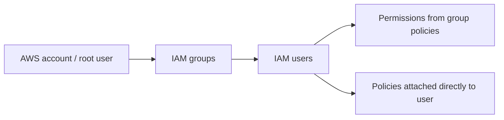
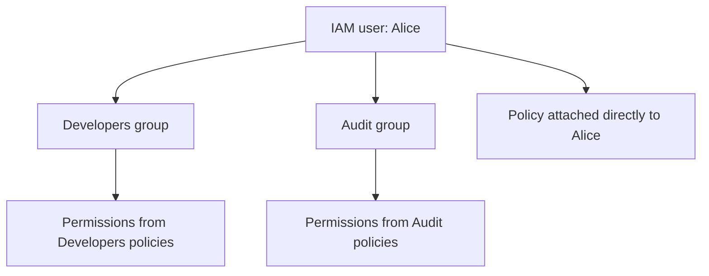
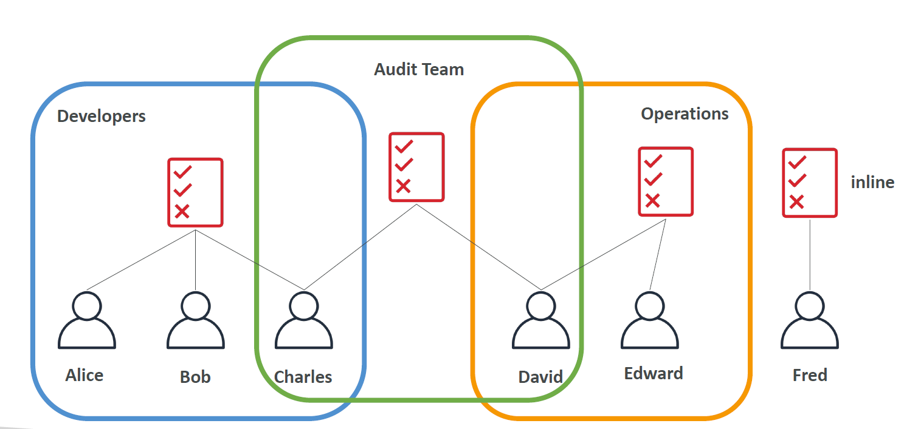
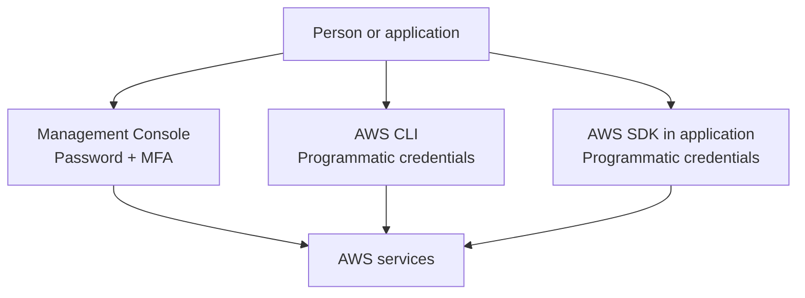
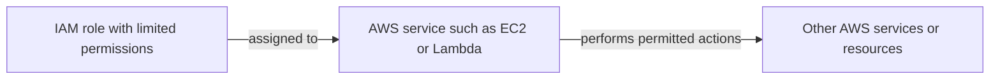

## Table of Contents

1. [IAM Foundations](#1-iam-foundations)
2. [IAM Policies and Permissions](#2-iam-policies-and-permissions)
3. [Authentication, MFA, and Ways to Access AWS](#3-authentication-mfa-and-ways-to-access-aws)
4. [IAM Roles, Auditing, and Best Practices](#4-iam-roles-auditing-and-best-practices)
5. [IAM Interview Revision](#5-iam-interview-revision)

---

## 1. IAM Foundations\n\n# 1. IAM Foundations

## What is AWS IAM?

**AWS Identity and Access Management (IAM)** is the AWS service used to manage identities and control who can access AWS resources and what actions they can perform.

- IAM is a **global service**.
- An AWS account has a root user by default.
- IAM users represent people who need access to the AWS account.
- IAM groups help organise users and assign permissions to multiple users.

## Root user

The root user is created when the AWS account is created.

Treat it as a highly privileged account:

- Do not use it for everyday administration.
- Do not share root credentials.
- Use it only when an account-level task specifically requires the root user.
- Protect it with MFA.

## IAM users

An IAM user is an identity for a person or workload that needs access in the account. In the course material, a user can have console credentials and/or programmatic credentials, depending on how access is required.

A useful operational guideline is:

> One physical person should have their own individual identity.

Do not let multiple people share one IAM user. Individual identities make access review and accountability easier.

## IAM groups

A group is a way to collect IAM users who need a common set of permissions.

Examples:

- `Developers`
- `Operations`
- `Audit`

Important rules:

- A group contains users, not other groups.
- A user does not have to belong to a group.
- A user can belong to more than one group.
- Permissions assigned to a group are available to its members.

For example, a developer may be a member of both `Developers` and `Audit`. The user's effective permissions can come from the groups they belong to and from policies attached directly to the user.



## Quick comparison

| IAM item | Meaning | Main purpose |
|---|---|---|
| Root user | Original account identity | Account ownership and exceptional account-level tasks |
| IAM user | Individual identity | Give a person an identity in AWS |
| IAM group | Collection of IAM users | Manage common permissions for multiple users |
| IAM policy | JSON permissions document | Define allowed or denied actions |

## Remember for interviews

- IAM is global.
- Groups contain users only; groups cannot be nested.
- A user can be in multiple groups.
- Avoid using the root user for normal daily work.
- Give each person an individual identity.\n\n---\n\n## 2. IAM Policies and Permissions\n\n# 2. IAM Policies and Permissions

## What is an IAM policy?

An IAM policy is a JSON document that defines permissions.

A policy describes:

- Which actions are allowed or denied.
- Which AWS resources those actions apply to.
- Which conditions must be true, if conditions are included.

Policies can be assigned to IAM users or groups. The course material also introduces an inline policy, which is attached directly to an identity rather than managed as a shared policy.

## Least privilege

**Least privilege** means giving an identity only the permissions it needs to do its job — no more.

Example:

A developer who only needs to view EC2 instance information should not automatically receive permission to delete EC2 instances or change unrelated services.

Why it matters:

- Reduces the impact of mistakes.
- Limits damage if credentials are compromised.
- Makes access easier to review.
- Avoids giving broad permissions “just in case”.

## IAM policy structure

A policy has a top-level structure:

| Element | Required? | Meaning |
|---|---:|---|
| `Version` | Yes | Policy language version. The course uses `2012-10-17`. |
| `Id` | No | Optional identifier for the policy. |
| `Statement` | Yes | One or more permission statements. |

Each statement can contain:

| Element | Required? | Meaning |
|---|---:|---|
| `Sid` | No | Optional statement identifier. |
| `Effect` | Yes | `Allow` or `Deny`. |
| `Principal` | Context-dependent | The account, user, or role the policy applies to in policy types that use a principal. |
| `Action` | Yes | The AWS actions being allowed or denied. |
| `Resource` | Yes | The resources to which the actions apply. |
| `Condition` | No | Optional conditions that control when the statement applies. |

**Important:** `Principal` is not used in every IAM policy type. The course slide lists the common policy elements at a high level; check AWS policy-type documentation when writing a real policy.

## Simplified example

This example allows read/list-style actions for EC2, Elastic Load Balancing, and CloudWatch. It is a learning example, not a complete production policy.

```json
{
  "Version": "2012-10-17",
  "Statement": [
    {
      "Effect": "Allow",
      "Action": "ec2:Describe*",
      "Resource": "*"
    },
    {
      "Effect": "Allow",
      "Action": "elasticloadbalancing:Describe*",
      "Resource": "*"
    },
    {
      "Effect": "Allow",
      "Action": [
        "cloudwatch:ListMetrics",
        "cloudwatch:GetMetricStatistics",
        "cloudwatch:Describe*"
      ],
      "Resource": "*"
    }
  ]
}
```

### How to read this example

- `Version` identifies the policy language version.
- `Statement` contains the permission rules.
- `Effect: Allow` means the listed actions are allowed by this statement.
- `Action` names the API actions.
- `Resource: "*"` means the statement is not restricted to a specific resource ARN.

Do not assume that `Resource: "*"` is appropriate for every permission. Use resource-level restrictions where the AWS service supports them and where they fit the requirement.

## Policy inheritance from groups

If a user belongs to a group, the user receives permissions granted through policies attached to that group. A user may also have a policy attached directly to the user.

Conceptually:



Review all relevant policy attachments when checking what a user can do.



## Interview points

1. What is an IAM policy?  
   A JSON document that defines permissions.

2. What is least privilege?  
   Grant only the access required to perform the task.

3. What is the difference between `Action` and `Resource`?  
   `Action` describes the API operation; `Resource` describes the target resource.

4. What is the purpose of `Effect`?  
   It specifies whether the statement allows or denies the listed actions.\n\n---\n\n## 3. Authentication, MFA, and Ways to Access AWS\n\n# 3. Authentication, MFA, and Ways to Access AWS

## IAM password policy

A password policy helps enforce stronger passwords for IAM users who sign in to the AWS Management Console.

The course material covers these settings:

- Minimum password length.
- Require uppercase letters.
- Require lowercase letters.
- Require numbers.
- Require non-alphanumeric characters.
- Allow users to change their own passwords.
- Set password expiration.
- Prevent password reuse.

A password policy improves password quality, but it should be combined with MFA and good credential-handling practices.

## Multi-Factor Authentication (MFA)

MFA adds another proof of identity during sign-in.

A simple way to remember it:

- Something you know — your password.
- Something you have — an authenticator or security device.

If someone steals only the password, MFA makes it harder for them to sign in successfully.

### MFA device options covered in the course

- Virtual MFA applications, such as Google Authenticator or Authy.
- U2F security keys, such as a YubiKey.
- Hardware key-fob MFA devices.

The available options may change. Check the AWS documentation and your organisation's security standards before selecting a device.

## Three ways to access AWS

AWS can be accessed through three common interfaces:

| Access method | Typical use | Credential method in the course |
|---|---|---|
| AWS Management Console | Work through the web interface | Password and MFA |
| AWS Command Line Interface (CLI) | Run AWS commands in a terminal or script | Access keys / configured credentials |
| AWS Software Development Kit (SDK) | Call AWS services from application code | Programmatic credentials |



## Access keys

Access keys are used for programmatic access, such as CLI commands and SDK calls.

An access key has two parts:

- **Access Key ID** — identifies the access key.
- **Secret Access Key** — secret value used to authenticate requests.

Treat the secret access key like a password:

- Never share it.
- Never commit it to GitHub.
- Do not paste it into tickets, chat messages, or documentation.
- Store credentials using an approved secure method.
- Rotate or deactivate credentials according to your organisation's process.

The course describes access keys as being generated through the AWS Console and managed by users. In current real-world environments, follow your organisation's preferred credential approach and AWS guidance; avoid long-lived keys when a safer temporary-credential option is available.

**Never copy the fake access key values shown in training slides into your notes or any real configuration.**

## AWS CLI

The AWS CLI is a command-line tool for interacting with AWS services.

It is useful when you want to:

- Run AWS operations from a terminal.
- Automate repeatable tasks with scripts.
- Work with AWS service APIs without using the web console.

Example commands (illustrative):

```bash
aws sts get-caller-identity
aws s3 ls
```

## AWS SDK

The AWS SDK provides language-specific libraries that let application code interact with AWS services.

Examples of supported language ecosystems include Python, Java, JavaScript, .NET, Go, PHP, and Ruby.

Typical use:

- An application needs to upload an object to S3.
- The application uses an SDK library.
- The SDK sends the request to the AWS service using configured credentials.

The AWS CLI is also built using an SDK.

## Interview points

- Console access is interactive; CLI and SDK access are programmatic.
- Access Key ID is not the secret. The Secret Access Key must remain confidential.
- MFA combines a password with a device or authenticator.
- Do not store credentials in source code or public repositories.\n\n---\n\n## 4. IAM Roles, Auditing, and Best Practices\n\n# 4. IAM Roles, Auditing, and Best Practices

## IAM roles for AWS services

Sometimes an AWS service needs permission to perform an action on your behalf.

Instead of putting a user's access keys inside the service or application, assign an IAM role to the service. The role provides the permissions the service needs.

Examples from the course:

- EC2 instance roles.
- Lambda function roles.
- CloudFormation roles.



### Example: EC2 instance role

Imagine an application running on an EC2 instance needs to read data from an AWS service.

At a high level:

1. Create or select an IAM role with the required permissions.
2. Associate the role with the EC2 instance.
3. The application uses the role's credentials when it makes permitted AWS requests.
4. The application does not need a hard-coded access key in its source code.

Keep the role permissions narrow. An EC2 instance should not receive broad administrator permissions if it only needs to read a specific set of resources.

## IAM security tools

The course introduces two tools for reviewing IAM access.

| Tool | Scope | What it helps you review |
|---|---|---|
| IAM Credentials Report | Account-level | Lists account users and the status of their credentials |
| IAM Access Advisor | User-level | Shows services a user has permission to access and when those services were last accessed |

### IAM Credentials Report

Use this report for an account-wide view of IAM users and credential status.

It can help identify users or credentials that need review.

### IAM Access Advisor

Use Access Advisor to understand which AWS services a user has permissions for and when those services were last accessed.

This information can help you identify permissions that may no longer be needed. Last-access information is an input to an access review; do not remove permissions without validating business and operational requirements.

## IAM best practices checklist

- [ ] Avoid using the root user for everyday tasks.
- [ ] Give each person an individual identity.
- [ ] Put users into groups where they share job responsibilities.
- [ ] Assign common permissions to groups where appropriate.
- [ ] Enforce a strong password policy for console users.
- [ ] Enable and enforce MFA.
- [ ] Use IAM roles to grant permissions to AWS services.
- [ ] Protect access keys and never share them.
- [ ] Audit credentials with the IAM Credentials Report.
- [ ] Review service access with IAM Access Advisor.
- [ ] Apply least privilege and remove access that is no longer required after proper review.

## Interview scenario

**Question:** An application running on EC2 needs to access an AWS service. Should you create an IAM user and store its access keys on the server?

**Good answer:** Prefer an IAM role attached to the EC2 instance. Grant only the permissions the application needs. This avoids placing long-lived user access keys in application files or server configuration.\n\n---\n\n## 5. IAM Interview Revision\n\n# 5. IAM Interview Revision

Try answering each question aloud before reading the short answer.

## Fundamentals

**1. What is AWS IAM?**  
IAM is the global AWS service used to manage identities and permissions.

**2. What is the root user?**  
It is the original identity created with the AWS account. Avoid using it for everyday work and protect it carefully.

**3. What is an IAM user?**  
An identity representing a person or other user that needs access to AWS.

**4. What is an IAM group?**  
A collection of IAM users. Groups help assign common permissions to multiple users.

**5. Can an IAM group contain another group?**  
No. IAM groups contain users, not other groups.

**6. Can one user belong to multiple groups?**  
Yes.

## Policies

**7. What is an IAM policy?**  
A JSON document that defines permissions.

**8. What does least privilege mean?**  
Give only the permissions required for the task.

**9. What is the purpose of `Effect`?**  
It specifies `Allow` or `Deny` for a statement.

**10. What does `Action` represent?**  
The AWS API operations covered by a statement.

**11. What does `Resource` represent?**  
The AWS resources to which the actions apply.

**12. What is a policy condition?**  
An optional rule that controls when a statement applies.

## Authentication and access

**13. What is MFA?**  
An additional authentication factor, typically a password plus a device or authenticator.

**14. What is the difference between an Access Key ID and Secret Access Key?**  
The ID identifies the key; the secret is confidential and must be protected.

**15. What is the AWS CLI?**  
A command-line tool for interacting with AWS services.

**16. What is the AWS SDK?**  
A set of language-specific libraries that application code can use to access AWS services.

**17. What are the three access methods covered in this topic?**  
Management Console, CLI, and SDK.

## Roles and auditing

**18. Why use an IAM role for EC2?**  
It gives the instance permissions to call AWS services without putting a user's long-lived access keys into the application.

**19. Name three examples of AWS services that can use roles.**  
EC2, Lambda, and CloudFormation.

**20. What is the IAM Credentials Report?**  
An account-level report showing users and the status of their credentials.

**21. What is IAM Access Advisor?**  
A user-level view of service permissions and when those services were last accessed.

**22. How can Access Advisor help with least privilege?**  
It can help identify permissions that may be unused and should be reviewed.

## Practical scenario questions

**23. A developer needs read-only access to EC2 information. What should you consider?**  
Create or assign a policy that grants only the required read/describe actions and limits resources where supported.

**24. A team of developers needs the same permissions. How can you manage this efficiently?**  
Create an IAM group, attach the appropriate policy to the group, and add the individual users.

**25. A developer has moved to another team. What should you review?**  
Their group memberships, directly attached policies, and any other access they still need. Remove old access only after confirming the new responsibilities.

**26. An EC2-hosted application needs to call an AWS API. What is the preferred IAM concept from this topic?**  
Use an IAM role for the EC2 instance with narrowly scoped permissions.

## Quick memory sheet

| Topic | Remember |
|---|---|
| IAM | Global identity and access service |
| Root user | Do not use for daily work |
| User | Individual identity |
| Group | Contains users only |
| Policy | JSON permissions document |
| Least privilege | Only required permissions |
| MFA | Password + device/authenticator |
| Console | Password + MFA |
| CLI / SDK | Programmatic access |
| Access keys | Keep secret; never share |
| Role | Permissions for AWS services |
| Credentials Report | Account-level credential review |
| Access Advisor | User-level service access review |\n\n---\n\n## Source and usage note

These notes are a paraphrased learning guide based on the stated course-slide range. The original course slides carry a **NOT FOR DISTRIBUTION** notice. Do not publish the original PDF, screenshots, or copied slide artwork in a public repository unless you have permission. These notes and diagrams are independently written; check the course licence before redistributing course-derived material.

AWS services, console screens, and recommended access patterns can change. Use the official AWS documentation when implementing IAM in a real environment.
