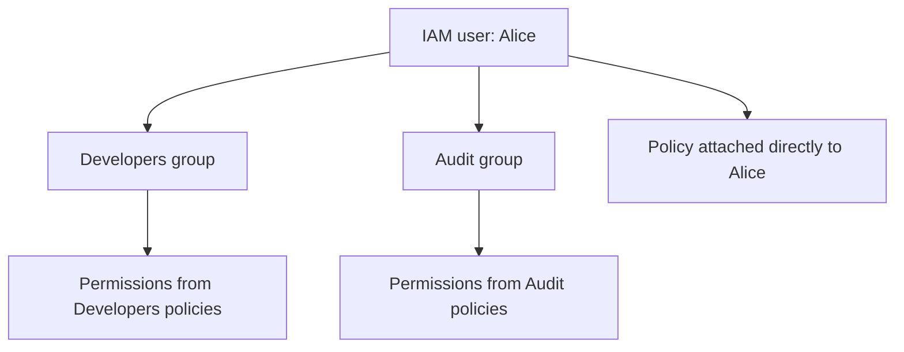

# 2. IAM Policies and Permissions

## What is an IAM policy?

An IAM policy is a JSON document that defines permissions.

A policy describes:

- Which actions are allowed or denied.
- Which AWS resources those actions apply to.
- Which conditions must be true, if conditions are included.

Policies can be assigned to IAM users or groups. The course material also introduces an inline policy, which is attached directly to an identity rather than managed as a shared policy.

## Least privilege

**Least privilege** means giving an identity only the permissions it needs to do its job — no more.

Example:

A developer who only needs to view EC2 instance information should not automatically receive permission to delete EC2 instances or change unrelated services.

Why it matters:

- Reduces the impact of mistakes.
- Limits damage if credentials are compromised.
- Makes access easier to review.
- Avoids giving broad permissions “just in case”.

## IAM policy structure

A policy has a top-level structure:

| Element | Required? | Meaning |
|---|---:|---|
| `Version` | Yes | Policy language version. The course uses `2012-10-17`. |
| `Id` | No | Optional identifier for the policy. |
| `Statement` | Yes | One or more permission statements. |

Each statement can contain:

| Element | Required? | Meaning |
|---|---:|---|
| `Sid` | No | Optional statement identifier. |
| `Effect` | Yes | `Allow` or `Deny`. |
| `Principal` | Context-dependent | The account, user, or role the policy applies to in policy types that use a principal. |
| `Action` | Yes | The AWS actions being allowed or denied. |
| `Resource` | Yes | The resources to which the actions apply. |
| `Condition` | No | Optional conditions that control when the statement applies. |

**Important:** `Principal` is not used in every IAM policy type. The course slide lists the common policy elements at a high level; check AWS policy-type documentation when writing a real policy.

## Simplified example

This example allows read/list-style actions for EC2, Elastic Load Balancing, and CloudWatch. It is a learning example, not a complete production policy.

```json
{
  "Version": "2012-10-17",
  "Statement": [
    {
      "Effect": "Allow",
      "Action": "ec2:Describe*",
      "Resource": "*"
    },
    {
      "Effect": "Allow",
      "Action": "elasticloadbalancing:Describe*",
      "Resource": "*"
    },
    {
      "Effect": "Allow",
      "Action": [
        "cloudwatch:ListMetrics",
        "cloudwatch:GetMetricStatistics",
        "cloudwatch:Describe*"
      ],
      "Resource": "*"
    }
  ]
}
```

### How to read this example

- `Version` identifies the policy language version.
- `Statement` contains the permission rules.
- `Effect: Allow` means the listed actions are allowed by this statement.
- `Action` names the API actions.
- `Resource: "*"` means the statement is not restricted to a specific resource ARN.

Do not assume that `Resource: "*"` is appropriate for every permission. Use resource-level restrictions where the AWS service supports them and where they fit the requirement.

## Policy inheritance from groups

If a user belongs to a group, the user receives permissions granted through policies attached to that group. A user may also have a policy attached directly to the user.

Conceptually:



Review all relevant policy attachments when checking what a user can do.

## Interview points

1. What is an IAM policy?  
   A JSON document that defines permissions.

2. What is least privilege?  
   Grant only the access required to perform the task.

3. What is the difference between `Action` and `Resource`?  
   `Action` describes the API operation; `Resource` describes the target resource.

4. What is the purpose of `Effect`?  
   It specifies whether the statement allows or denies the listed actions.
