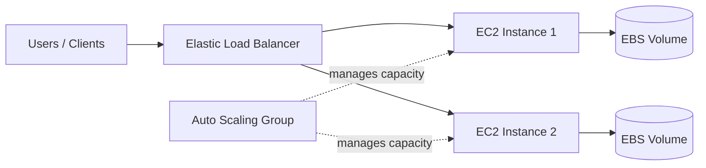
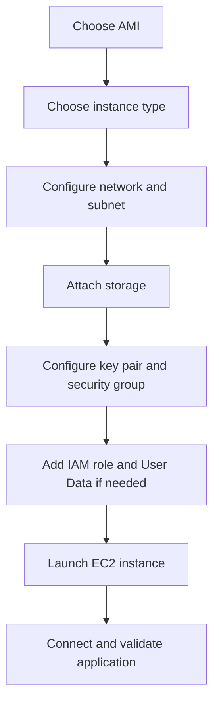
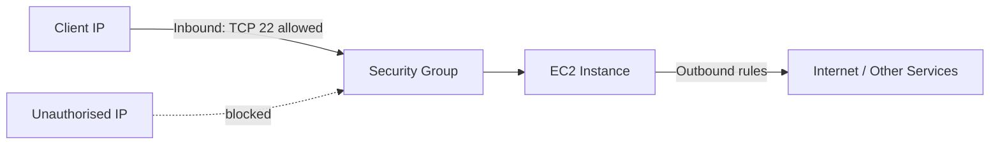
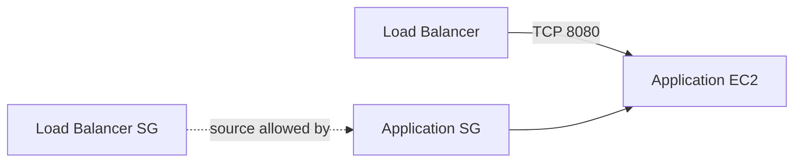
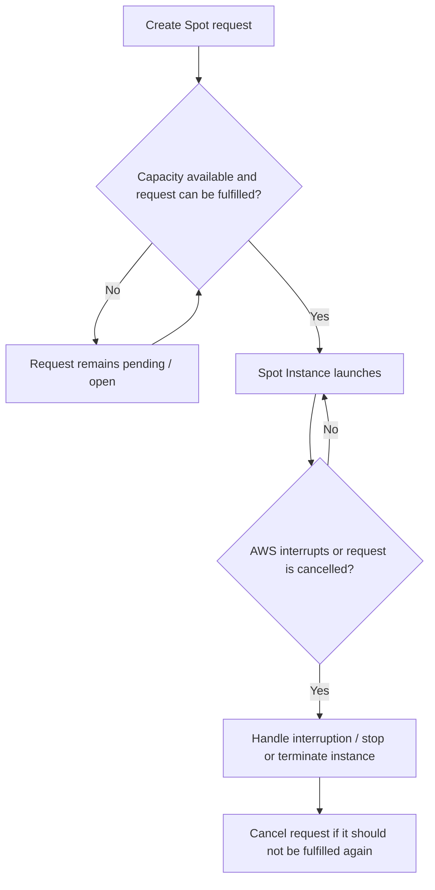
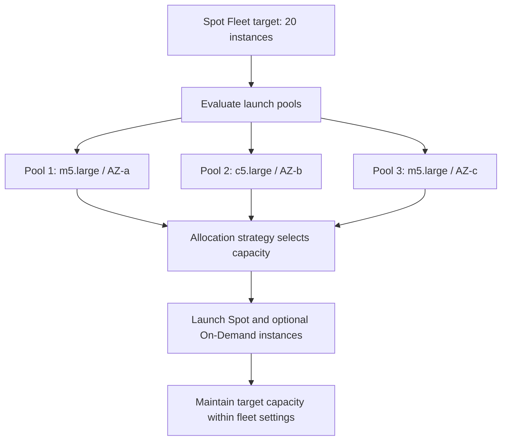

# ☁️ Amazon EC2 – Basics & Purchasing Options

## 🧭 1. What is Amazon EC2?

**Amazon EC2 (Elastic Compute Cloud)** is an **Infrastructure as a Service (IaaS)** offering. It provides resizable virtual servers in the AWS Cloud.

Think of EC2 as renting a computer in an AWS data centre. You choose its operating system, CPU, memory, storage, and networking, then run your application on it.

### EC2's main building blocks

| Service | What it does |
|---|---|
| **EC2** | Runs virtual machines (instances). |
| **EBS (Elastic Block Store)** | Provides persistent block storage volumes for EC2. |
| **ELB (Elastic Load Balancing)** | Distributes incoming traffic across targets such as EC2 instances. |
| **ASG (Auto Scaling Group)** | Automatically adds or removes EC2 instances to match demand or maintain capacity. |



**Example:** A web application runs on multiple EC2 instances. An ELB distributes requests, while an ASG increases or decreases the number of instances based on demand.

---

## ⚙️ 2. EC2 Instance Configuration

When launching an EC2 instance, you choose several settings:

| Setting | Meaning | Example / Why it matters |
|---|---|---|
| **AMI (Amazon Machine Image)** | Template used to create the instance. It includes an OS and may include pre-installed software. | Amazon Linux, Ubuntu, Windows Server |
| **Instance type** | Defines CPU, memory, networking, and sometimes local storage capacity. | `t3.micro`, `m7i.large` |
| **Storage** | Disk space attached to or physically available on the instance. | EBS, EFS, Instance Store |
| **Key pair** | Public/private cryptographic key pair used for secure login to supported instances. | `.pem` private key |
| **VPC and subnet** | Determine the network in which the instance is launched. | Public or private subnet |
| **Security group** | Virtual firewall controlling allowed inbound and outbound traffic. | Allow TCP 22 from your IP |
| **Public / private IP** | Addresses used to communicate with the instance. | Public IP for internet access; private IP inside a VPC |
| **IAM instance profile / role** | Gives applications on the instance temporary AWS permissions. | Read objects from S3 |
| **User Data** | Startup script used to bootstrap the instance. | Install Nginx during first boot |

### A simple launch flow



### Important terms

- **vCPU:** Virtual CPU presented to the instance.
- **RAM:** Memory used by running processes and applications.
- **AMI:** A reusable machine image / launch template source; it is not the running server itself.
- **Subnet:** A range of IP addresses inside a VPC in which resources are launched.
- **EBS volume:** Network-attached block storage that can persist independently of the life of an instance, depending on its delete-on-termination setting.
- **Instance Store:** Temporary block storage physically attached to the host. Data is lost when the instance is stopped, hibernated, or terminated, depending on the instance type and event.

> 💡 **Selection tip:** Estimate CPU, RAM, storage IOPS/throughput, network throughput, and workload behaviour before choosing an instance. Bigger is not automatically better.

---

## 🚀 3. EC2 User Data (Bootstrapping)

**Bootstrapping** means running initial configuration commands when an instance starts.

**EC2 User Data** lets you pass a script to an instance at launch. It is commonly used to:
- Install operating-system updates.
- Install packages such as Nginx or Apache.
- Download application files.
- Create directories and configuration files.
- Start services.

For Linux instances, a basic shell script commonly begins with `#!/bin/bash`.

```bash
#!/bin/bash
dnf update -y
dnf install -y httpd
systemctl enable httpd
systemctl start httpd
echo "Hello from EC2 User Data" > /var/www/html/index.html
```

### User Data — key points

- By default, User Data scripts run **only during the first boot** of the instance.
- On Linux, the script normally runs with **root privileges**. Do not put passwords, access keys, or other secrets in it.
- User Data is useful for repeatable initial setup, but it is not a full configuration-management system.
- If you need ongoing configuration enforcement, consider tools such as **AWS Systems Manager**, **Ansible**, or another configuration-management solution.

> ⚠️ The slide describes User Data as running once at first start. There are ways to configure cloud-init to run scripts again, but that requires deliberate configuration; do not assume a normal User Data script runs on every reboot.

---

## 🧩 4. EC2 Instance Types

An **instance type** determines the hardware resources available to your virtual server. AWS offers different families for different workload patterns.

### Understanding the instance name

Example: `m5.2xlarge`

| Part | Meaning |
|---|---|
| `m` | Instance family / class — here, General Purpose |
| `5` | Generation of that family |
| `2xlarge` | Size within the family |

Another example: `c5d.4xlarge`
- `c` = Compute Optimized family
- `5` = generation
- `d` = local instance-store NVMe storage variant
- `4xlarge` = size

The exact suffix meanings depend on the family. Always check the current AWS instance-type documentation.

### Main instance families

| Family | Optimised for | Typical workloads |
|---|---|---|
| **General Purpose** (`t`, `m`) | Balanced CPU, memory, and networking | Web servers, application servers, development environments, code repositories |
| **Compute Optimized** (`c`) | High CPU performance | Batch processing, media transcoding, high-performance web servers, HPC, scientific modelling, gaming servers |
| **Memory Optimized** (`r`, `x`, `u`, etc.) | Large in-memory datasets | Relational / NoSQL databases, caches, real-time analytics, in-memory BI |
| **Storage Optimized** (`i`, `d`, `h`, etc.) | High local-storage I/O and sequential reads/writes | OLTP, NoSQL, data warehousing, distributed file systems, local caching |
| **Accelerated Computing** (`p`, `g`, `inf`, etc.) | GPUs or purpose-built accelerators | Machine learning, graphics, video processing, inference |
| **HPC Optimized** | High-performance compute and tightly coupled workloads | Large scientific simulations, engineering workloads, complex modelling |

### Quick memory aid

- **General:** balanced resources.
- **Compute:** CPU-heavy.
- **Memory:** RAM-heavy.
- **Storage:** disk I/O-heavy.
- **Accelerated:** GPU / accelerator-heavy.
- **HPC:** high-performance, tightly coupled computation.

### Instance examples from the tutorial

The slide's examples illustrate how resources vary by instance type. These are historical examples, not a current sizing recommendation.

| Example type | vCPU | Memory | Storage shown in slide |
|---|---:|---:|---|
| `t2.micro` | 1 | 1 GiB | EBS only |
| `t2.xlarge` | 4 | 16 GiB | EBS only |
| `c5d.4xlarge` | 16 | 32 GiB | 1 × 400 GB NVMe SSD |
| `r5.16xlarge` | 64 | 512 GiB | EBS only |
| `m5.8xlarge` | 32 | 128 GiB | EBS only |

**Important:** Instance availability, specifications, and prices change. Check the current [AWS EC2 instance types](https://aws.amazon.com/ec2/instance-types/) page or [instances.vantage.sh](https://instances.vantage.sh/) before selecting one.

---

## 🛡️ 5. Security Groups

A **Security Group (SG)** is a virtual, stateful firewall associated with network interfaces used by EC2 instances. It controls which network traffic is allowed to reach or leave an instance.

### Inbound vs outbound

- **Inbound rule:** Controls traffic coming **into** the instance.
- **Outbound rule:** Controls traffic going **out of** the instance.
- A rule typically specifies a protocol, port range, and source (inbound) or destination (outbound).



### Security Group facts

1. Security Groups contain **allow rules only**. You cannot add an explicit deny rule to a Security Group.
2. They are **stateful**: if inbound traffic is allowed, response traffic for that connection is automatically allowed, even if there is no matching outbound rule (and vice versa).
3. All inbound traffic is blocked by default for a newly created Security Group.
4. A newly created Security Group commonly has an allow-all outbound rule by default. If you remove it, outbound traffic is restricted by the remaining rules.
5. A Security Group can be associated with multiple EC2 instances / network interfaces.
6. A Security Group belongs to a **VPC** and is not a global, cross-region firewall.
7. Rules can reference IP ranges (IPv4 / IPv6) or another Security Group.
8. Security Groups are enforced outside the guest operating system. Blocked packets do not reach the application on the instance.

### Referencing another Security Group

Instead of allowing a changing list of server IP addresses, one Security Group can allow traffic from another Security Group.

**Example:** The application server's Security Group allows TCP port `8080` from the load balancer's Security Group. Any eligible instance associated with that load balancer Security Group can be a source.



This is useful when instances scale in and out because you do not need to keep updating individual IP addresses.

### Security Group troubleshooting

| Symptom | Possible cause |
|---|---|
| Connection times out | Traffic may be blocked by a Security Group, network ACL, route table, firewall, or missing network path. |
| Connection refused | The host may be reachable, but the application is not listening on that port, or the service is stopped. |
| SSH fails | Check inbound TCP 22, source IP, route/public reachability, key permissions, username, and instance status. |

> 🔐 **Best practice:** Allow SSH (TCP 22) only from your trusted IP or VPN range. Avoid opening SSH to `0.0.0.0/0` unless there is a specific, temporary reason.

### Common ports to remember

| Port | Protocol / service | Purpose |
|---:|---|---|
| **22** | SSH | Secure command-line access to Linux |
| **21** | FTP control | File Transfer Protocol |
| **22** | SFTP | Secure file transfer over SSH |
| **80** | HTTP | Unencrypted web traffic |
| **443** | HTTPS | Encrypted web traffic using TLS |
| **3389** | RDP | Remote Desktop access to Windows |

**Remember:** FTP and SFTP are different protocols. SFTP uses SSH and normally uses port 22.

---

## 🔑 6. Connecting to an EC2 Instance

You can connect to an instance using SSH, PuTTY, or browser-based EC2 Instance Connect, depending on the operating system and instance configuration.

### SSH (Linux / macOS / Windows OpenSSH)

**SSH (Secure Shell)** provides encrypted remote command-line access. The standard SSH port is **TCP 22**.

Example:

```bash
ssh -i "my-key.pem" ec2-user@<PUBLIC_IP>
```

- `-i` specifies the private key file.
- `ec2-user` is a common default username for Amazon Linux. Ubuntu commonly uses `ubuntu`; usernames vary by AMI.
- `<PUBLIC_IP>` is the instance's reachable public IPv4 address or DNS name.

On Linux / macOS, protect the private key:

```bash
chmod 400 my-key.pem
```

On Windows, OpenSSH can be used from PowerShell. If Windows reports **Bad permissions**, restrict access to the private key file so other users cannot read it.

### PuTTY (Windows)

PuTTY is an SSH client commonly used on Windows. Traditional PuTTY workflows may require converting a PEM private key to PuTTY's PPK format using **PuTTYgen**.

### EC2 Instance Connect

- Provides browser-based connection to supported EC2 instances.
- AWS temporarily makes a public key available to the instance for the connection.
- You do not need to manage a long-lived private key file for that browser session.
- Network access to SSH (TCP 22) must still be permitted.
- Availability depends on the AMI, operating system, Region, and instance/network configuration; it is not limited universally to Amazon Linux 2.

### SSH troubleshooting checklist

1. Confirm the instance is running and has passed status checks.
2. Confirm you are using the correct public IP / DNS name and login username.
3. Confirm the Security Group permits inbound TCP 22 from your current public IP.
4. Confirm the subnet route and internet connectivity are correct (for direct internet SSH, the instance needs a suitable public path).
5. Confirm the private key matches the key pair configured at launch.
6. On Windows / Linux / macOS, ensure private-key file permissions are sufficiently restrictive.
7. Try EC2 Instance Connect if it is supported and configured.

---

## 💳 7. EC2 Purchasing Options

AWS provides multiple pricing models. Choose based on **workload duration, flexibility, interruption tolerance, capacity needs, and licensing requirements**.

### At-a-glance comparison

| Option | Commitment | Discount / cost idea | Best for |
|---|---|---|---|
| **On-Demand** | None | Standard On-Demand rate | Short-term, unpredictable, or flexible workloads |
| **Reserved Instances (RI)** | 1 or 3 years | Discount for commitment | Predictable, steady-state EC2 usage |
| **Convertible RI** | 1 or 3 years | Discount, with more flexibility to exchange attributes | Steady usage where requirements may change |
| **Savings Plans** | 1 or 3 years; commit to $/hour usage | Discount up to plan terms; excess usage is On-Demand | Consistent usage with more flexibility than a fixed configuration |
| **Spot Instances** | No long-term commitment | Can be much cheaper; can be interrupted | Fault-tolerant, flexible, interruptible workloads |
| **Dedicated Hosts** | On-Demand or reservation | Usually expensive | Physical server control, licensing, compliance |
| **Dedicated Instances** | Pay for dedicated instance capacity | Dedicated hardware; pricing differs from shared tenancy | Workloads requiring hardware dedicated to one customer |
| **Capacity Reservations** | No term commitment; reserve in a specific AZ | Charged at On-Demand rates whether used or not | Need guaranteed capacity in a particular AZ |

> **Exam focus:** Understand the trade-offs and use cases. The percentage discounts and hourly prices shown in older course slides are examples only; AWS pricing changes by Region, instance type, OS, and date.

### 7.1 On-Demand Instances

- Pay for compute capacity as you use it.
- No long-term commitment and no upfront reservation commitment.
- Usually the most flexible option, but often more expensive than commitment-based pricing for steady usage.
- Suitable for short-term, unpredictable, development, testing, or newly launched workloads.

**Choose On-Demand when:** you cannot confidently predict usage or do not want a long-term commitment.

### 7.2 Reserved Instances (RIs)

- Commitment for **1 year or 3 years**.
- Best suited to predictable, steady-state usage.
- Reservation attributes can include instance family/type, Region, platform (OS), tenancy, and scope.
- Payment options can include No Upfront, Partial Upfront, and All Upfront.
- **Regional RI:** provides a billing discount across matching usage in a Region; it does not reserve capacity in a specific AZ.
- **Zonal RI:** is tied to a specific AZ and can provide a capacity reservation for matching instances.
- **Convertible RI:** allows exchanges for different instance attributes, subject to AWS exchange rules.

**Choose RI when:** you have stable EC2 usage and can commit for one or three years.

### 7.3 Savings Plans

You commit to a consistent amount of eligible compute usage, measured in **USD per hour**, for 1 or 3 years.

- Usage covered by the commitment receives the plan's discounted rate.
- Usage beyond the commitment is charged at the applicable On-Demand rate.
- Payment options include No Upfront, Partial Upfront, and All Upfront.

There are two important EC2-related plan types:

| Plan type | Flexibility |
|---|---|
| **Compute Savings Plans** | Most flexible: can apply across EC2 instance families, sizes, Regions, OS, and tenancy, and also to eligible services such as Fargate and Lambda. |
| **EC2 Instance Savings Plans** | More specific: commit to an instance family in a Region; flexible across size, OS, and tenancy within that family / Region. |

**Choose Savings Plans when:** you have predictable compute spend but want more flexibility than a fixed Reserved Instance.

### 7.4 Spot Instances

- Use spare AWS EC2 capacity at a potentially large discount compared with On-Demand.
- AWS can interrupt Spot Instances when it needs the capacity back or when applicable Spot conditions are met.
- AWS generally provides a **two-minute interruption notice** when possible.
- Suitable for workloads designed to handle interruptions.

**Good use cases:**
- Batch processing
- Data analysis
- Image / video processing
- Distributed and parallel workloads
- CI workers and test jobs that can be restarted
- Workloads with flexible start and end times

**Avoid Spot for:** a single, interruption-intolerant database or a critical process that cannot checkpoint, retry, or recover.

> ⚠️ Spot is not a traditional auction where you simply outbid another customer. Spot pricing and capacity are managed by AWS. A maximum price can be configured, but for many workloads AWS recommends using the default maximum price (On-Demand price) and designing for interruption.

### 7.5 Dedicated Hosts

- A **physical server** dedicated to your use.
- Gives visibility and control over host placement and instance placement on the host.
- Useful for **BYOL (Bring Your Own License)** when software licensing is based on sockets, cores, or physical hosts.
- Can help meet regulatory or compliance requirements.
- Can be purchased On-Demand or through a reservation.
- Usually the most expensive tenancy option.

**Choose Dedicated Hosts when:** physical-server visibility / placement or host-based licensing is a requirement.

### 7.6 Dedicated Instances

- EC2 instances run on hardware dedicated to a single customer.
- They may share that hardware with other instances belonging to the same AWS account.
- You do not get the same host-level visibility and placement control as with Dedicated Hosts.
- Placement can change after stop / start operations.

**Key distinction:** Dedicated Host = dedicated physical server with host-level control; Dedicated Instance = dedicated hardware tenancy without the same host management controls.

### 7.7 Capacity Reservations

- Reserve On-Demand EC2 capacity in a **specific Availability Zone (AZ)**.
- Can be created or cancelled when needed; no 1-year / 3-year term is required.
- You pay the On-Demand rate for the reserved capacity whether you launch an instance or not.
- A Capacity Reservation by itself does **not** provide a discount.
- It can be combined with eligible Regional Reserved Instances or Savings Plans for billing discounts.

**Choose Capacity Reservations when:** you must be able to launch a specific instance type in a particular AZ, for example during a planned business-critical event.

---

## 🧠 8. Purchasing Options — Easy Analogy

Imagine booking rooms at a hotel:

| EC2 option | Hotel analogy |
|---|---|
| On-Demand | Walk in whenever you want and pay the standard rate. |
| Reserved Instance | Commit to a longer stay in advance for a better rate. |
| Savings Plan | Commit to spending a fixed amount per hour; get flexibility within the plan's rules. |
| Spot | Use a room that may be reclaimed at short notice; it is cheaper but not guaranteed. |
| Dedicated Host | Book the entire building / physical property for your use. |
| Dedicated Instance | Get a room in a property where the physical facilities are dedicated to your customer. |
| Capacity Reservation | Reserve a room in a specific hotel location and pay even if you do not use it. |

---

## 🌩️ 9. Spot Instance Requests and Spot Fleets

### Spot request basics

A Spot request asks AWS for Spot capacity that matches your requirements.

- A request can specify capacity requirements and launch parameters.
- Spot capacity and price can vary by instance type and Availability Zone.
- Spot Instances can be interrupted; applications should save progress and recover gracefully.
- **Cancelling a Spot request does not automatically terminate already-running Spot Instances.** Cancel the request and then separately terminate associated instances if you want them stopped.

### Spot request lifecycle — simplified



**Important operational point:** Manage the request and the instance as separate resources. Check the request state and the instance state.

### Spot Fleet

A **Spot Fleet** is a collection of Spot Instances and, optionally, On-Demand Instances managed to meet a target capacity.

You define one or more **launch pools**. A launch pool is a possible combination of:
- Instance type (for example, `m5.large`)
- Operating system / AMI and launch configuration
- Availability Zone

The fleet can select from multiple pools, improving the chance of finding capacity.

### Spot Fleet allocation strategies

| Strategy | How it chooses capacity | Typical reason to use |
|---|---|---|
| **lowestPrice** | Chooses the pool with the lowest price. | Cost-focused, shorter workloads |
| **diversified** | Spreads capacity across pools. | Better distribution and resilience |
| **capacityOptimized** | Prioritises pools with the best available Spot capacity. | Reduce interruption / capacity risk |
| **priceCapacityOptimized** | Prioritises pools with strong capacity availability, then considers price. | Good general-purpose choice; recommended in the tutorial |

A fleet stops launching when it reaches its target capacity or meets its configured limits.



---

## 🧪 10. Practical Scenarios

| Scenario | Best fit | Why |
|---|---|---|
| A new application with unknown traffic and duration | On-Demand | No commitment while usage is uncertain |
| A database server expected to run continuously for years | RI or Savings Plan | Predictable usage can benefit from commitment discounts |
| A workload that can restart from checkpoints | Spot | Low cost and interruption can be handled |
| A licensed application that requires physical host-level licensing | Dedicated Host | Host visibility and placement support licensing requirements |
| A critical deployment that must launch in a particular AZ during a planned window | Capacity Reservation | Reserves capacity in that AZ |
| A fleet of parallel image-processing workers | Spot Fleet | Can use multiple pools and allocation strategies |
| A web server needing balanced CPU and memory | General Purpose instance | Balanced resources |
| Video transcoding or CPU-heavy batch jobs | Compute Optimized instance | High compute performance |
| Large in-memory cache | Memory Optimized instance | High memory capacity |
| High-throughput local storage processing | Storage Optimized instance | Optimised local storage I/O |

---

## 🎯 11. Exam Revision — Must Remember

1. **EC2 = IaaS** — virtual servers in AWS.
2. EC2 works with **EBS** for block storage, **ELB** for traffic distribution, and **ASG** for scaling.
3. **User Data** bootstraps an instance; by default it runs on the first boot.
4. Instance name example: `m5.2xlarge` = family `m`, generation `5`, size `2xlarge`.
5. **General / Compute / Memory / Storage / Accelerated / HPC** are the main workload categories.
6. **Security Groups are stateful** and contain allow rules only.
7. New Security Groups block inbound traffic by default; default outbound rules commonly allow all outbound traffic.
8. Security Groups can reference other Security Groups — useful for dynamic fleets.
9. Know ports: **22 SSH/SFTP, 21 FTP, 80 HTTP, 443 HTTPS, 3389 RDP**.
10. **SSH** requires a reachable network path, permitted TCP 22, correct username, and matching private key.
11. **On-Demand** = no commitment; **RI / Savings Plans** = commitment-based savings.
12. **Spot** = inexpensive spare capacity, but interruptible.
13. **Dedicated Host** gives physical host control; **Dedicated Instance** gives dedicated hardware tenancy without the same host control.
14. **Capacity Reservation** guarantees capacity in a specific AZ but does not itself discount the price.
15. Cancelling a Spot request does **not** automatically terminate its running instances.
16. **Spot Fleet** can use multiple pools and allocation strategies; `priceCapacityOptimized` is a strong general-purpose choice.

---

## 📚 12. Glossary

| Term | Meaning |
|---|---|
| **AMI** | Amazon Machine Image — template used to launch an EC2 instance. |
| **ASG** | Auto Scaling Group — maintains or adjusts EC2 fleet capacity. |
| **AZ** | Availability Zone — isolated location within an AWS Region. |
| **BYOL** | Bring Your Own License — use an existing software licence on AWS. |
| **EBS** | Elastic Block Store — persistent block storage for EC2. |
| **EC2** | Elastic Compute Cloud — AWS virtual compute service. |
| **EFS** | Elastic File System — managed shared file storage. |
| **ELB** | Elastic Load Balancing — distributes traffic across targets. |
| **HPC** | High-Performance Computing — large-scale, compute-intensive workloads. |
| **IaaS** | Infrastructure as a Service — cloud infrastructure such as virtual machines. |
| **IAM Role** | Identity that provides temporary permissions to an AWS service or workload. |
| **IOPS** | Input / Output Operations Per Second — storage performance measure. |
| **RDP** | Remote Desktop Protocol — remote GUI access, commonly to Windows. |
| **SG** | Security Group — stateful virtual firewall. |
| **SSH** | Secure Shell — encrypted remote command-line protocol. |
| **SFTP** | SSH File Transfer Protocol — secure file transfer over SSH. |
| **vCPU** | Virtual CPU — virtualised compute unit presented to an instance. |

---

## ➕ 13. Extra Concepts Added for Completeness

These are short supporting concepts that help connect the tutorial topics to real EC2 operations.

### AMI vs EC2 Instance
- **AMI** is the template / image.
- **EC2 instance** is the running virtual machine created from that image.
- You can create a custom AMI from a configured instance and use it to launch similar instances.

### Key Pair
- EC2 key pairs are used for secure login to supported operating systems.
- AWS stores the public key; you must protect the private key.
- AWS does not let you download the same private key again after creation. Keep a secure backup.
- Never commit `.pem`, `.ppk`, passwords, or credentials to GitHub.

### Public IP vs Private IP
- A **private IP** is used for communication inside the VPC and connected networks.
- A **public IPv4 address** can provide internet reachability when the subnet routing and security configuration also allow it.
- A public IP alone does not make an instance reachable; routes, gateways, Security Groups, and network ACLs must also permit the path.

### Stop vs Terminate
- **Stop:** shuts down an EBS-backed instance; it can usually be started again. Compute charges stop, but attached EBS storage and other billable resources can continue to incur charges.
- **Terminate:** permanently deletes the instance. EBS volumes may be deleted or retained depending on their delete-on-termination settings. Instance Store data is not preserved.
- **Reboot:** restarts the operating system without the same lifecycle effect as stop / start.

### Stateful Security Group vs Stateless Network ACL
- **Security Group:** stateful; return traffic is automatically allowed for an allowed connection.
- **Network ACL (NACL):** stateless subnet-level network filter; inbound and outbound rules must both allow the traffic, including return traffic.
- This distinction is useful when troubleshooting network connectivity.

### EC2 Pricing Reminder
The tutorial's price table and discount percentages are snapshots. Do not memorise the dollar values. Learn the purchasing model, commitment, flexibility, interruption behaviour, and capacity guarantees.

---

## 🔗 14. Official References

- [Amazon EC2 — User Guide](https://docs.aws.amazon.com/AWSEC2/latest/UserGuide/concepts.html)
- [EC2 instance types](https://aws.amazon.com/ec2/instance-types/)
- [Security groups for EC2](https://docs.aws.amazon.com/AWSEC2/latest/UserGuide/ec2-security-groups.html)
- [EC2 User Data](https://docs.aws.amazon.com/AWSEC2/latest/UserGuide/user-data.html)
- [EC2 purchasing options](https://docs.aws.amazon.com/AWSEC2/latest/UserGuide/instance-purchasing-options.html)
- [Spot Instances](https://docs.aws.amazon.com/AWSEC2/latest/UserGuide/using-spot-instances.html)
- [Spot Fleet](https://docs.aws.amazon.com/AWSEC2/latest/UserGuide/spot-fleet.html)

---

<sub>Personal study notes written in original wording from the topics covered in the EC2 tutorial slides (PDF pages 41–77), with clearly labelled supplementary explanations. Instance families, features, and pricing can change; use current AWS documentation for production decisions.</sub>
