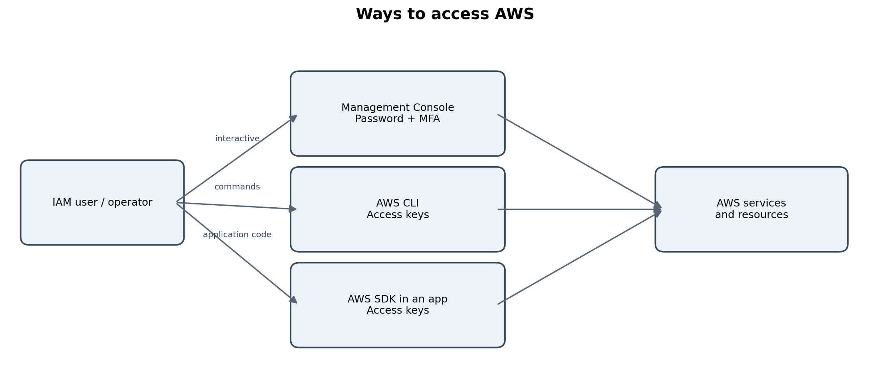

# 3. Authentication, MFA, and Ways to Access AWS

## IAM password policy

A password policy helps enforce stronger passwords for IAM users who sign in to the AWS Management Console.

The course material covers these settings:

- Minimum password length.
- Require uppercase letters.
- Require lowercase letters.
- Require numbers.
- Require non-alphanumeric characters.
- Allow users to change their own passwords.
- Set password expiration.
- Prevent password reuse.

A password policy improves password quality, but it should be combined with MFA and good credential-handling practices.

## Multi-Factor Authentication (MFA)

MFA adds another proof of identity during sign-in.

A simple way to remember it:

- Something you know — your password.
- Something you have — an authenticator or security device.

If someone steals only the password, MFA makes it harder for them to sign in successfully.

### MFA device options covered in the course

- Virtual MFA applications, such as Google Authenticator or Authy.
- U2F security keys, such as a YubiKey.
- Hardware key-fob MFA devices.

The available options may change. Check the AWS documentation and your organisation's security standards before selecting a device.

## Three ways to access AWS

AWS can be accessed through three common interfaces:

| Access method | Typical use | Credential method in the course |
|---|---|---|
| AWS Management Console | Work through the web interface | Password and MFA |
| AWS Command Line Interface (CLI) | Run AWS commands in a terminal or script | Access keys / configured credentials |
| AWS Software Development Kit (SDK) | Call AWS services from application code | Programmatic credentials |



## Access keys

Access keys are used for programmatic access, such as CLI commands and SDK calls.

An access key has two parts:

- **Access Key ID** — identifies the access key.
- **Secret Access Key** — secret value used to authenticate requests.

Treat the secret access key like a password:

- Never share it.
- Never commit it to GitHub.
- Do not paste it into tickets, chat messages, or documentation.
- Store credentials using an approved secure method.
- Rotate or deactivate credentials according to your organisation's process.

The course describes access keys as being generated through the AWS Console and managed by users. In current real-world environments, follow your organisation's preferred credential approach and AWS guidance; avoid long-lived keys when a safer temporary-credential option is available.

**Never copy the fake access key values shown in training slides into your notes or any real configuration.**

## AWS CLI

The AWS CLI is a command-line tool for interacting with AWS services.

It is useful when you want to:

- Run AWS operations from a terminal.
- Automate repeatable tasks with scripts.
- Work with AWS service APIs without using the web console.

Example commands (illustrative):

```bash
aws sts get-caller-identity
aws s3 ls
```

## AWS SDK

The AWS SDK provides language-specific libraries that let application code interact with AWS services.

Examples of supported language ecosystems include Python, Java, JavaScript, .NET, Go, PHP, and Ruby.

Typical use:

- An application needs to upload an object to S3.
- The application uses an SDK library.
- The SDK sends the request to the AWS service using configured credentials.

The AWS CLI is also built using an SDK.

## Interview points

- Console access is interactive; CLI and SDK access are programmatic.
- Access Key ID is not the secret. The Secret Access Key must remain confidential.
- MFA combines a password with a device or authenticator.
- Do not store credentials in source code or public repositories.
