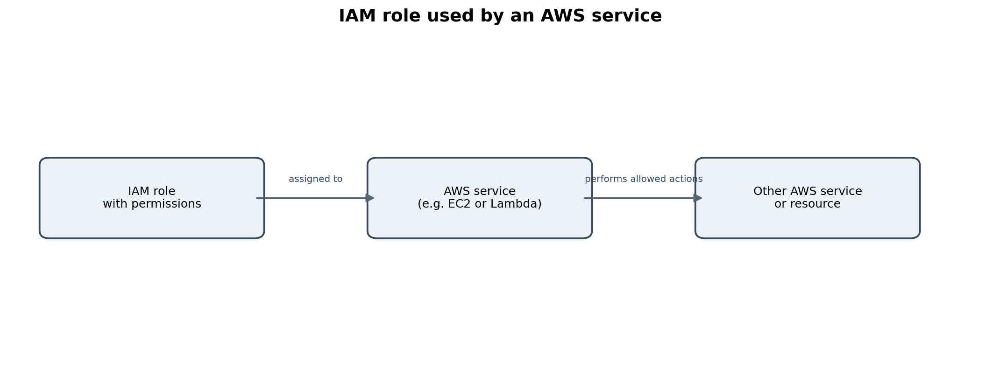

# 4. IAM Roles, Auditing, and Best Practices

## IAM roles for AWS services

Sometimes an AWS service needs permission to perform an action on your behalf.

Instead of putting a user's access keys inside the service or application, assign an IAM role to the service. The role provides the permissions the service needs.

Examples from the course:

- EC2 instance roles.
- Lambda function roles.
- CloudFormation roles.

### Example: EC2 instance role

Imagine an application running on an EC2 instance needs to read data from an AWS service.

At a high level:

1. Create or select an IAM role with the required permissions.
2. Associate the role with the EC2 instance.
3. The application uses the role's credentials when it makes permitted AWS requests.
4. The application does not need a hard-coded access key in its source code.

Keep the role permissions narrow. An EC2 instance should not receive broad administrator permissions if it only needs to read a specific set of resources.

## IAM security tools

The course introduces two tools for reviewing IAM access.

| Tool | Scope | What it helps you review |
|---|---|---|
| IAM Credentials Report | Account-level | Lists account users and the status of their credentials |
| IAM Access Advisor | User-level | Shows services a user has permission to access and when those services were last accessed |

### IAM Credentials Report

Use this report for an account-wide view of IAM users and credential status.

It can help identify users or credentials that need review.

### IAM Access Advisor

Use Access Advisor to understand which AWS services a user has permissions for and when those services were last accessed.

This information can help you identify permissions that may no longer be needed. Last-access information is an input to an access review; do not remove permissions without validating business and operational requirements.

## IAM best practices checklist

- [ ] Avoid using the root user for everyday tasks.
- [ ] Give each person an individual identity.
- [ ] Put users into groups where they share job responsibilities.
- [ ] Assign common permissions to groups where appropriate.
- [ ] Enforce a strong password policy for console users.
- [ ] Enable and enforce MFA.
- [ ] Use IAM roles to grant permissions to AWS services.
- [ ] Protect access keys and never share them.
- [ ] Audit credentials with the IAM Credentials Report.
- [ ] Review service access with IAM Access Advisor.
- [ ] Apply least privilege and remove access that is no longer required after proper review.

## Interview scenario

**Question:** An application running on EC2 needs to access an AWS service. Should you create an IAM user and store its access keys on the server?

**Good answer:** Prefer an IAM role attached to the EC2 instance. Grant only the permissions the application needs. This avoids placing long-lived user access keys in application files or server configuration.
